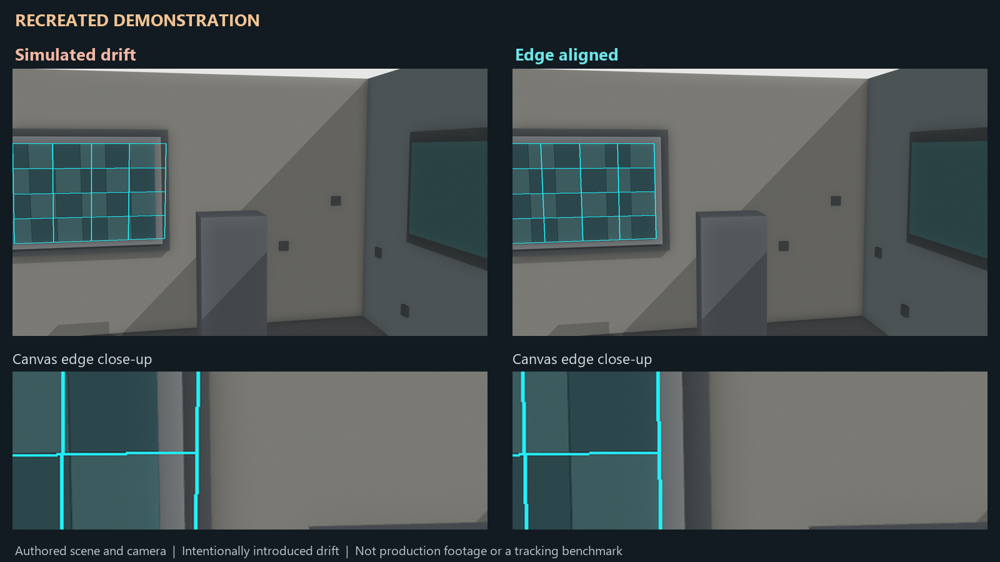

# Synthetic examples

These examples were created for the public article. They contain no production footage, production project data, or imagery from the original shot.

- `recreated-comparison.mp4`: eight-second authored scene comparing intentionally introduced drift with an aligned insert. Every frame is labeled **RECREATED DEMONSTRATION**. This is not a camera-solver benchmark or a capture of the original production result.
- `recreated-comparison-poster.webp`: a still from the same demonstration.
- `edge-alignment.webp`: an illustrative close-up showing alignment to the inner canvas boundary.

Only these three exact media filenames are permitted by `.gitignore`. To add another example, review both its visible content and embedded metadata, add its exact path to `.gitignore`, and document its origin here. Avoid source timecode, production names, private paths, and identifiable production imagery.

